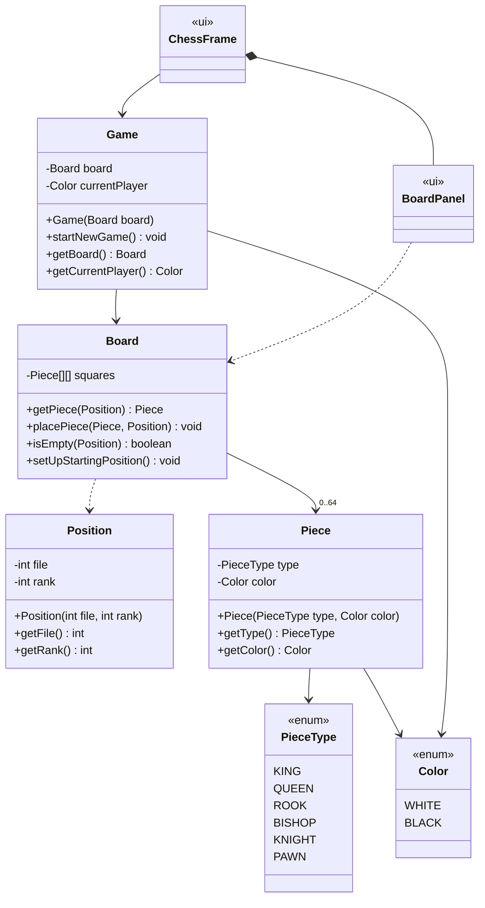

# Design: Game Setup Phase

Requirements: [docs/requirements/game-setup.md](../requirements/game-setup.md)

## Goals
- Keep the design as small as possible: only the classes the Game Setup feature needs.
- Keep all game logic in `domain` so it can be unit tested without the GUI.
- The GUI (`ui`, Java Swing) only reads from the domain and draws it.

## Classes

### `domain` package
| Class | Responsibility |
|-------|----------------|
| `Color` (enum) | The two sides: `WHITE`, `BLACK`. |
| `PieceType` (enum) | The six kinds of pieces. |
| `Position` | One square on the board. `file` is 0–7 (`a`–`h`), `rank` is 0–7 (`1`–`8`). The constructor throws `IllegalArgumentException` for values outside 0–7. Immutable; implements `equals`/`hashCode`. |
| `Piece` | A piece's type and color. Immutable. Movement rules are not part of this feature. |
| `Board` | The 8×8 grid. Gets, places, and checks pieces at a `Position`. `setUpStartingPosition()` clears the board and places all 32 pieces. |
| `Game` | Owns the `Board` and whose turn it is. `startNewGame()` calls `board.setUpStartingPosition()` and sets the current player to `WHITE`. |

### `ui` package (Java Swing)
| Class | Responsibility |
|-------|----------------|
| `Main` | Entry point. Creates a `Game`, starts a new game, and opens a `ChessFrame` on the Swing event thread. |
| `ChessFrame` | The `JFrame`. Holds the `BoardPanel` and a "New Game" menu item. |
| `BoardPanel` | Draws the 64 squares and the pieces by reading the `Board`. |

## Design Decisions
- **`Game` receives its `Board` through the constructor.** This lets the `Game` tests pass in a mock
  `Board` (EasyMock) and check that `startNewGame()` calls `setUpStartingPosition()`.
- **No separate setup or factory class.** Placing the starting pieces is one method on `Board`. We can
  split it out later if it grows.
- **`Position` checks its own bounds.** This puts the boundary values (−1, 0, 7, 8) in one class, which
  makes the BVA simple.
- **The GUI is not unit tested.** Per the BVA rules, view classes and enums do not need BVA files.

## BVA Files to Write
One file per non-view, non-enum class in `docs/bva/`:
- `Position.md`
- `Piece.md`
- `Board.md`
- `Game.md`

## Suggested Task Split
| Task | Classes | Branch (example) |
|------|---------|------------------|
| 1 | `Color`, `PieceType`, `Piece` | `feature/piece` |
| 2 | `Position` | `feature/position` |
| 3 | `Board` (incl. `setUpStartingPosition`) | `feature/board` |
| 4 | `Game`, plus the Swing `Main`, `ChessFrame`, `BoardPanel` | `feature/game-and-gui` |

Task 3 depends on Tasks 1 and 2, and Task 4 depends on Task 3. To work in parallel, agree on the
method signatures above first. Then each person can write their tests against those signatures (using
mocks where needed) before the other classes are merged.
