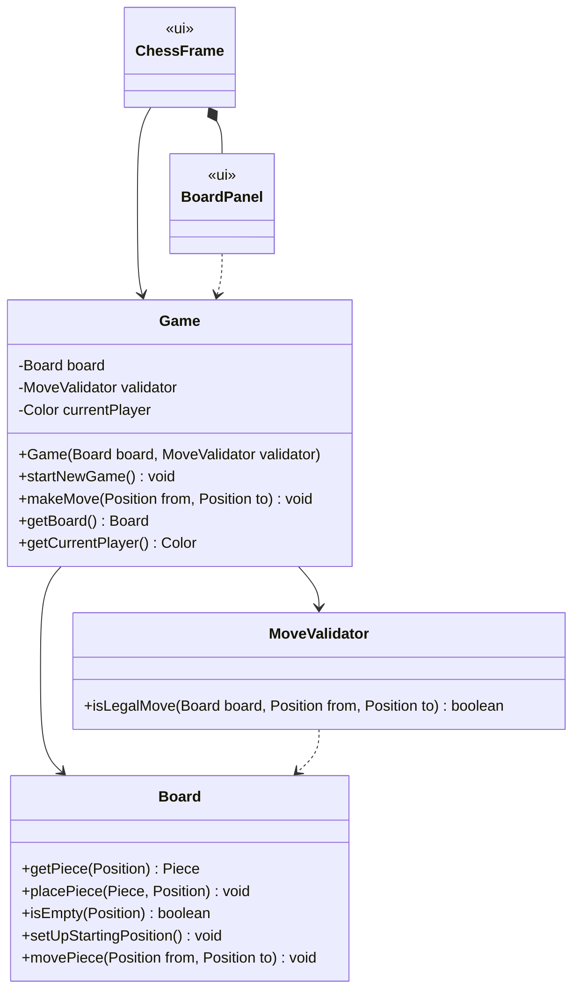

# Design: One Turn of the Game

Requirements: [docs/requirements/one-turn.md](../requirements/one-turn.md)
Builds on: [docs/design/game-setup.md](game-setup.md)

## Goals
- Add the smallest set of changes needed for one legal move.
- Keep move rules in `domain`, separate from turn handling, so each can be unit tested on its own.
- `Game` gets its `MoveValidator` through the constructor, so `Game` tests can mock it.

## Classes
New and changed members only. Everything else is unchanged from the Game Setup design.



### `domain` package
| Class | Change | Responsibility |
|-------|--------|----------------|
| `MoveValidator` | **New** | Decides whether a move follows the moving piece's movement rule. Checks the pattern (e.g. L-shape for a Knight) and, for Rook, Bishop, and Queen, that every square strictly between `from` and `to` is empty. It does **not** check turn order or the destination's color. Those are `Game`'s job. |
| `Board` | **Add** `movePiece(from, to)` | Moves the piece at `from` to `to` and empties `from`. Any piece already on `to` is replaced, which is how a capture happens. No rule checking. |
| `Game` | **Change** the constructor; **add** `makeMove(from, to)` | Enforces turn rules, asks `MoveValidator` about the movement rule, moves the piece on the `Board`, and switches the current player. |
| `Position` | Needs PR #13 merged | Relies on the bounds checks and `equals`/`hashCode` from the Position task. |

### `Game.makeMove(from, to)` steps
Each check throws `IllegalArgumentException` with a message the GUI can show. Nothing changes when a check fails.
1. `from` is empty → "There is no piece on that square."
2. The piece at `from` is not the current player's → "That is not your piece."
3. `to` holds a piece of the current player's color → "You cannot capture your own piece."
4. `validator.isLegalMove(board, from, to)` is `false` → "That piece cannot move there."
5. Otherwise: `board.movePiece(from, to)`, then switch the current player.

### Movement rules (`MoveValidator`)
Ranks are 0–7 in code (rank 1–8 on the board). White moves toward rank index 7, Black toward rank index 0.

| Piece | Legal when |
|-------|------------|
| Pawn | 1 square forward onto an empty square; 2 squares forward from its starting rank (White index 1, Black index 6) when both squares are empty; 1 square diagonally forward only onto an opponent's piece |
| Knight | (file change, rank change) is (±1, ±2) or (±2, ±1). Ignores pieces in between |
| King | Moves at most 1 square along each axis, and moves at least 1 square |
| Rook | Same file or same rank, and the path is clear |
| Bishop | Same distance on both axes (a diagonal), and the path is clear |
| Queen | Rook or Bishop rule |

`from` equal to `to` is never legal.

### `ui` package (Java Swing)
| Class | Change |
|-------|--------|
| `BoardPanel` | Turns a mouse click into a `Position`, remembering that rank 8 is drawn on the top row. First click selects one of the current player's pieces and highlights it. A second click calls `game.makeMove`. Clicking the selected square again deselects it. Repaints after each move. |
| `ChessFrame` | Adds a turn label ("White to move" / "Black to move"). Shows the message from `IllegalArgumentException` in a dialog. "New Game" also clears the selection and resets the label. |
| `Main` | Builds `new Game(new Board(), new MoveValidator())`. |

## Design Decisions
- **`MoveValidator` is a separate class, not a method on `Piece`.** Movement depends on the board (blocking,
  pawn captures), and `Piece` doesn't know the board. Keeping it separate also lets `Game` tests mock it.
- **One `MoveValidator` with a `switch` on `PieceType`, not one class per piece.** Six small classes would be
  overkill at this stage. Each piece gets a private helper method. If the class grows (castling, en passant),
  we can split it later.
- **Illegal moves throw `IllegalArgumentException`.** The exception message tells the player why the move was
  rejected, which a `boolean` return value can't.
- **Check is ignored for now.** Detecting moves into check needs to know which squares are attacked. That
  belongs to the win-condition features.

## Shared Stubs (merge first)
Merge these as one small PR before the other tasks start, so everyone can compile and mock against them:

```java
public class MoveValidator {
    public boolean isLegalMove(Board board, Position from, Position to) {
        return false;
    }
}
```

- `Board.movePiece(Position from, Position to)` with an empty body
- `Game(Board board, MoveValidator validator)` constructor, and `makeMove(Position from, Position to)` with an empty body
- Update `Main` and `GameTests` to use the new constructor

## BVA Files to Write or Update
- `docs/bva/MoveValidator.md` (new). The Pawn/Knight/King and Rook/Bishop/Queen tasks each add their own section.
- `docs/bva/Board.md`: add `movePiece`.
- `docs/bva/Game.md`: add `makeMove` and the new constructor.

## Task Split
| Task | Classes | Branch (example) |
|------|---------|------------------|
| 1 | `MoveValidator`: Pawn, Knight, King | `feature/move-rules-pawn-knight-king` |
| 2 | `MoveValidator`: Rook, Bishop, Queen | `feature/move-rules-sliding` |
| 3 | Shared stubs, `Board.movePiece`, `Game.makeMove` | `feature/make-move` |
| 4 | `BoardPanel`, `ChessFrame`, `Main` (click-to-move GUI) | `feature/click-to-move-gui` |

All four tasks can be worked on at the same time once the shared stubs are merged. Tasks use mocks or
stubs for the classes they don't own.
