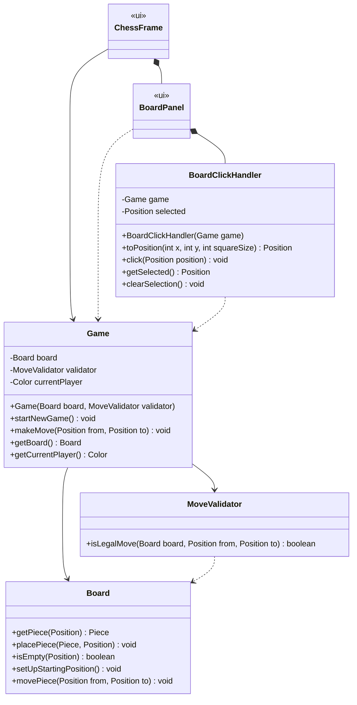

# Design: One Turn of the Game

Requirements: [docs/requirements/one-turn.md](../requirements/one-turn.md)
Builds on: [docs/design/game-setup.md](game-setup.md)

## Goals
- Add the smallest set of changes needed for one legal move.
- Keep move rules in `domain`, separate from turn handling, so each can be unit tested on its own.
- `Game` gets its `MoveValidator` through the constructor, so `Game` tests can mock it.

## Classes
New and changed members only. Everything else is unchanged from the Game Setup design.

### `domain` package
| Class | Change | Responsibility |
|-------|--------|----------------|
| `MoveValidator` | **New** | Decides whether a move follows the moving piece's movement rule. Checks the pattern (e.g. L-shape for a Knight) and, for Rook, Bishop, and Queen, that every square strictly between `from` and `to` is empty. It does **not** check turn order or the destination's color. Those are `Game`'s job. |
| `Board` | **Add** `movePiece(from, to)` | Moves the piece at `from` to `to` and empties `from`. Any piece already on `to` is replaced, which is how a capture happens. No rule checking. |
| `Game` | **Change** the constructor; **add** `makeMove(from, to)` | Enforces turn rules, asks `MoveValidator` about the movement rule, moves the piece on the `Board`, and switches the current player. |
| `Position` | Needs PR #13 merged | Relies on the bounds checks and `equals`/`hashCode` from the Position task. |

### `Game.makeMove(from, to)` steps
Each check throws `IllegalArgumentException` with a message the GUI can show. Nothing changes when a check fails.
1. `from` is empty → "There is no piece on that square."
2. The piece at `from` is not the current player's → "That is not your piece."
3. `to` holds a piece of the current player's color → "You cannot capture your own piece."
4. `validator.isLegalMove(board, from, to)` is `false` → "That piece cannot move there."
5. Otherwise: `board.movePiece(from, to)`, then switch the current player.

### Movement rules (`MoveValidator`)
Ranks are 0–7 in code (rank 1–8 on the board). White moves toward rank index 7, Black toward rank index 0.

| Piece | Legal when |
|-------|------------|
| Pawn | 1 square forward onto an empty square; 2 squares forward from its starting rank (White index 1, Black index 6) when both squares are empty; 1 square diagonally forward only onto an opponent's piece |
| Knight | (file change, rank change) is (±1, ±2) or (±2, ±1). Ignores pieces in between |
| King | Moves at most 1 square along each axis, and moves at least 1 square |
| Rook | Same file or same rank, and the path is clear |
| Bishop | Same distance on both axes (a diagonal), and the path is clear |
| Queen | Rook or Bishop rule |

`from` equal to `to` is never legal.

### `ui` package (Java Swing)
| Class | Change |
|-------|--------|
| `BoardClickHandler` | **New.** The click-to-move logic, kept out of Swing so it can be unit tested. `toPosition` turns a pixel into a `Position` (rank 8 on the top row) and returns `null` off the board. `click` selects one of the current player's pieces, deselects when the selected square is clicked again, and otherwise calls `game.makeMove` once. The selection is cleared before `makeMove` runs, so it is also cleared when the move is illegal; the `IllegalArgumentException` is passed on unchanged. A `null` (off-board) click is ignored. |
| `BoardPanel` | Forwards each mouse press to `BoardClickHandler`, highlights the selected square, and repaints after each click. Reports illegal-move messages and board changes to `ChessFrame` through callbacks. |
| `ChessFrame` | Adds a turn label ("White to move" / "Black to move"). Shows the message from `IllegalArgumentException` in a dialog. "New Game" also clears the selection and resets the label. |
| `Main` | Builds `new Game(new Board(), new MoveValidator())`. |

## Design Decisions
- **`MoveValidator` is a separate class, not a method on `Piece`.** Movement depends on the board (blocking,
  pawn captures), and `Piece` doesn't know the board. Keeping it separate also lets `Game` tests mock it.
- **One `MoveValidator` with a `switch` on `PieceType`, not one class per piece.** Six small classes would be
  overkill at this stage. Each piece gets a private helper method. If the class grows (castling, en passant),
  we can split it later.
- **Illegal moves throw `IllegalArgumentException`.** The exception message tells the player why the move was
  rejected, which a `boolean` return value can't.
- **Click handling is split out of `BoardPanel` into `BoardClickHandler`.** Pixel-to-square mapping and the
  select/deselect/move rules are real logic, so they get TDD and BVA. `BoardPanel` is left with drawing and
  forwarding clicks, which is view code.
- **Check is ignored for now.** Detecting moves into check needs to know which squares are attacked. That
  belongs to the win-condition features.

## Shared Signatures
Everyone codes against these exact signatures. Each task stubs or mocks the parts it doesn't own in its own
branch. If two branches add the same stub, keep the real implementation when resolving the merge conflict.

- `MoveValidator.isLegalMove(Board board, Position from, Position to): boolean`
- `Board.movePiece(Position from, Position to): void`
- `Game(Board board, MoveValidator validator)`
- `Game.makeMove(Position from, Position to): void`, throws `IllegalArgumentException` for illegal moves

## BVA Files to Write or Update
- `docs/bva/MoveValidator.md` (new). The Pawn/Knight/King and Rook/Bishop/Queen tasks each add their own section.
- `docs/bva/Board.md`: add `movePiece`.
- `docs/bva/Game.md`: add `makeMove` and the new constructor.
- `docs/bva/BoardClickHandler.md` (new). Done by the click-to-move GUI task.

## Task Split
| Task | Classes | Branch (example) |
|------|---------|------------------|
| 1 | `MoveValidator`: Pawn, Knight, King | `feature/move-rules-pawn-knight-king` |
| 2 | `MoveValidator`: Rook, Bishop, Queen | `feature/move-rules-sliding` |
| 3 | `Board.movePiece`, `Game.makeMove` (turn rules and captures) | `feature/make-move` |
| 4 | `BoardClickHandler`, `BoardPanel`, `ChessFrame`, `Main` (click-to-move GUI) | `feature/click-to-move-gui` |

All four tasks can be worked on at the same time. Each task uses mocks or stubs for the classes it doesn't own.
